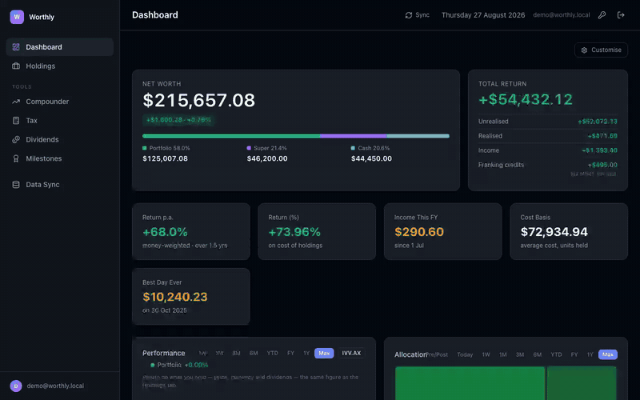
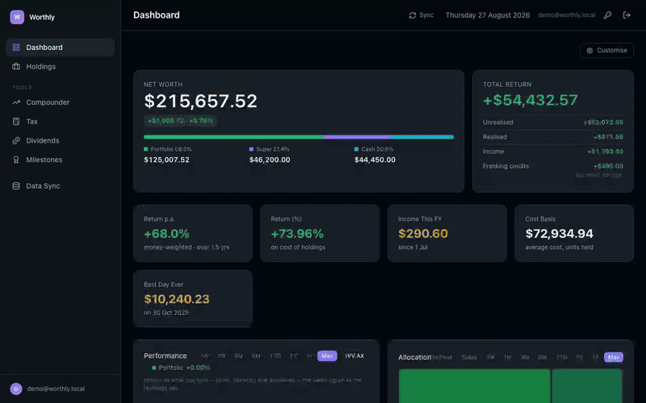
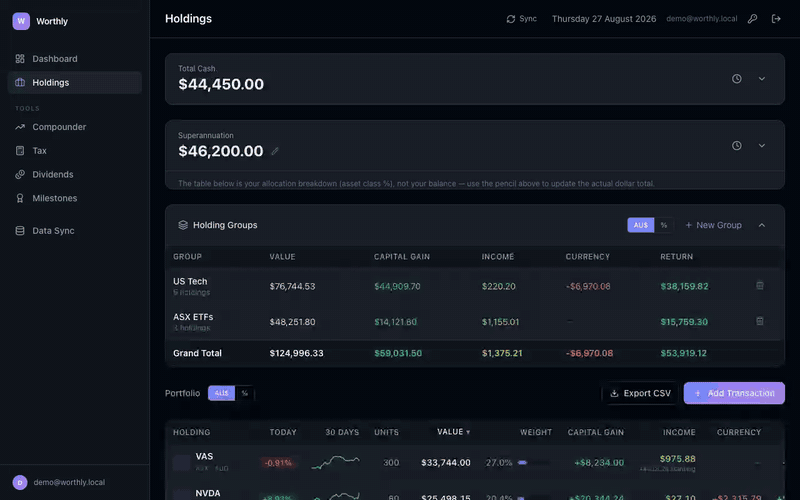
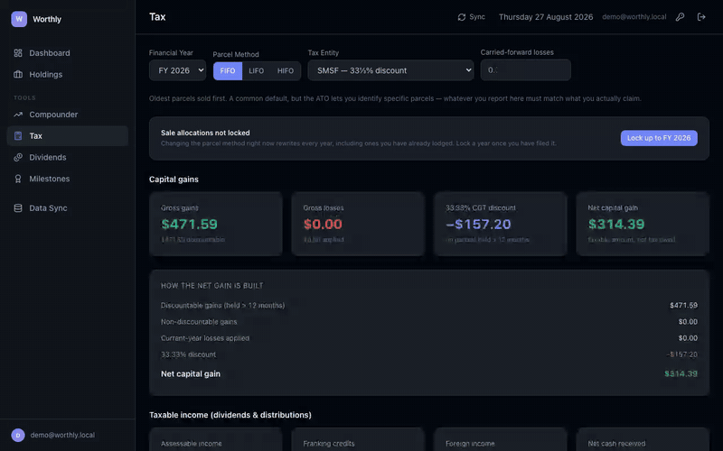
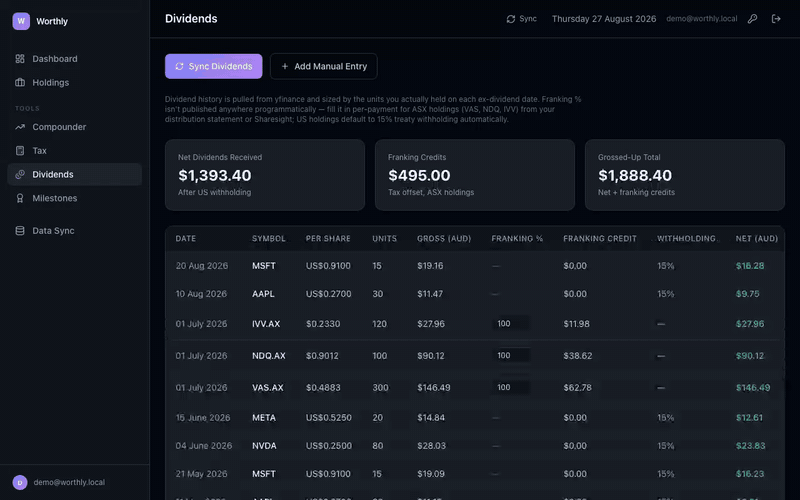
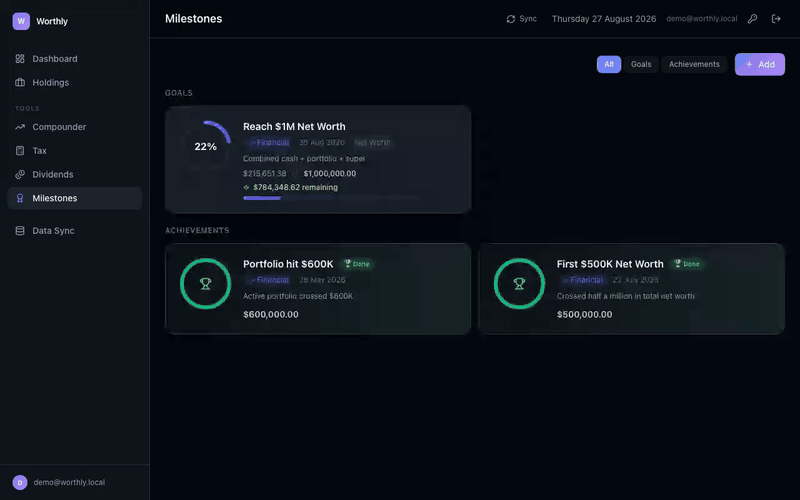
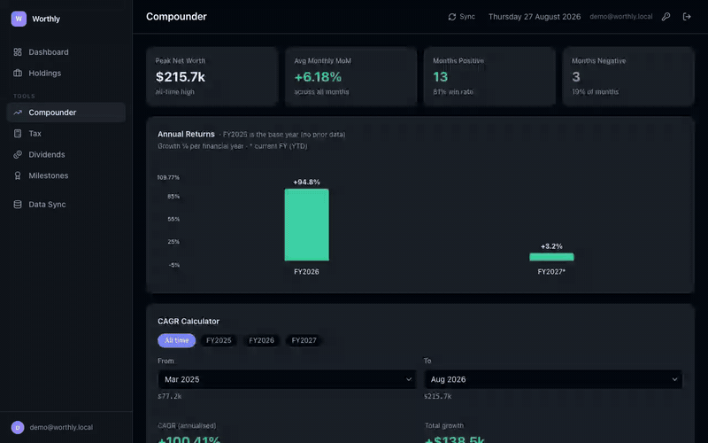
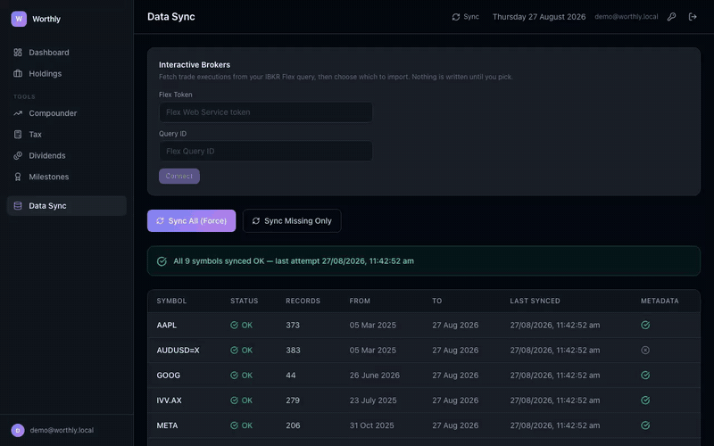
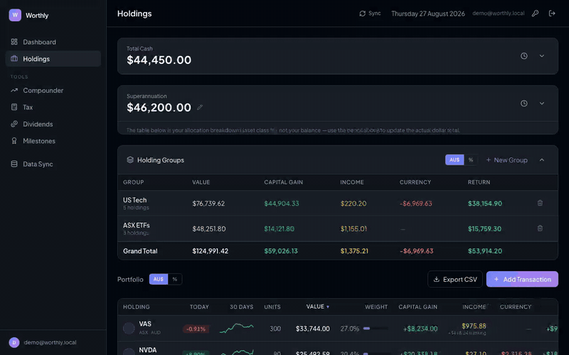

# Worthly

**Self-hosted net worth & portfolio dashboard** - multi-currency (AUD/USD), live Yahoo Finance prices, Australian CGT calculations, and dividend/franking tracking. Your data, your server, no third party ever sees it.

<!--
  Badge row - the build badge only works once this repo has run at least one
  GitHub Actions workflow on `main`. Swap kbdevops/worthly if the repo moves.
-->
[](https://github.com/kbdevops/worthly/actions)




## Contents

- [Features](#features)
- [Quick Start](#quick-start)
- [Docker](#docker)
- [Configuration](#configuration)
- [Tech Stack](#tech-stack)
- [Project Structure](#project-structure)
- [Contributing](#contributing)

## Features

### Dashboard
Customisable, drag-to-reorder widgets - net worth timeline, allocation breakdown, holding performance, monthly change - with 5 color themes and configurable stat cards.

Today's change is a **true AUD move**: for a USD holding, price and exchange rate are each converted at their own day's rate, and the two legs are reported separately. Converting both at today's rate cancels the currency move out entirely, which on a day the dollar moves reports roughly half the real figure - so the card tells you whether the share moved or the dollar did.


#### Customise
Top-left **Customise** opens the layout editor: pick which stat cards show, toggle or reorder widgets, and switch between five themes or dial in a custom accent hue - the whole page recolours live.



### Holdings
Every position with full transaction history. Click into any holding for per-lot gain/loss, add or delete trades, sector/industry metadata pulled automatically.





### Tax (Australian CGT)
CGT calculations with the 50% long-term discount applied automatically, per-parcel breakdown, optimal sell-date suggestions.





### Dividends
Full dividend history auto-fetched from Yahoo Finance, sized by the units you actually held on each ex-dividend date. Tracks Australian franking credits (manually entered - no feed publishes these) and US treaty withholding tax automatically, with net and grossed-up totals.



### Milestones
Goals that track live app data - pick one metric or combine several (e.g. Cash + Portfolio), set a target in AUD or USD (USD targets convert to their live AUD equivalent every time you open the app, so progress moves with the exchange rate). Plus an achievements log for past milestones.





### Compounder
Long-run growth view: monthly net worth history, Australian FY annual snapshots (Jul-Jun) with per-year growth, and a CAGR calculator you can point at any two months or jump to a financial year with one click.

Returns under a year are reported as plain cumulative growth rather than annualised - annualising a short period produces numbers that are arithmetically true and completely meaningless (a 3% move over two days annualises to roughly 25,000%).



### Data Sync
Background sync runs automatically twice a day (after ASX and NYSE/NASDAQ close). The Sync tab surfaces real health - per-symbol errors, staleness warnings, last-run results - instead of a black box.



#### How prices stay current

Three layers, deliberately arranged so there's no yfinance traffic when nobody's using the app:

| Layer | When | What it does |
|---|---|---|
| **Full sync** | 06:15 UTC (after ASX close) and 21:15 UTC (after US close) | Fetches full daily history, holding metadata, dividends |
| **Scheduled intraday** | Every 5 min, extended hours only (`INTRADAY_REFRESH_MINUTES`) | Overwrites today's price so the cache never goes cold |
| **On-demand refresh** | Whenever `/api/portfolio` is read and prices are stale (`LIVE_REFRESH_SECONDS`, default 60s) | Kicks a background refresh; this is what actually makes the app feel live |

The on-demand layer is the important one. A scheduler can only ever be as fresh as its
interval, so opening the app used to show prices up to 15 minutes old. Now the frontend's
60-second poll of `/api/portfolio` triggers a refresh when the cache is stale, so simply
having the page open keeps it current. It's fire-and-forget: a refresh of ~11 symbols takes
about a second, but the request returns immediately with what's in the database and the next
poll picks up the newer numbers. Requests are never blocked on a network fetch.

**Trading windows** (UTC, weekdays only - approximate, and holidays aren't modelled; on a
non-trading day yfinance simply returns nothing and the refresh is a no-op):

- **ASX** 21:00-06:10 - pre-open auction through close
- **US** 08:00-00:00 - pre-market from 04:00 ET through after-hours to 20:00 ET

Refreshing gates on *extended* hours, not just the regular session. Gating on regular
sessions alone meant US pre-market and after-hours moves never reached the database until
the next full sync, even though the Pre/After Market card reads those quotes live.

To force a refresh regardless of staleness or market hours:

```bash
curl -X POST -H "Authorization: Bearer $TOKEN" http://localhost:5050/api/prices/refresh
```

**On genuinely live streaming:** this is polling, not a stream. Sub-second updates would
need a WebSocket feed pushed to the browser over SSE, which is a real piece of work in a
single-worker Flask app (persistent connections, reconnect handling). Polling gets you to
"a few seconds stale when you look at it", which is the right trade for a portfolio tracker.

### Brokerage import (Interactive Brokers)
Connect an IBKR **Flex Web Service** token and query ID once, then fetch your trade executions and **choose which to import**. Nothing is written to your ledger until you pick.

Every candidate is classified against what you already have:

| Badge | Meaning | Ticked by default |
|---|---|---|
| **New** | Nothing in your ledger resembles it | yes |
| **Replaces manual** | Same date, size and price as a hand-entered row | no |
| **Same trade, different date** | Matches on size and price, within 5 days | no |
| **Already imported** | A previous sync already has this exact fill | no |

The third case is the one that matters. IBKR reports the **US execution date**, while a hand-typed entry often carries the **Australian** one - a fill on Friday afternoon in New York is already Saturday in Sydney. Matching on date equality alone labels those as new, and importing them double-counts the position. Each flagged row shows your existing entry beside IBKR's, both dates visible, so you can see the offset instead of guessing.

Ticking a flagged row imports IBKR's version and deletes the manual row it supersedes - the broker's figures are the authoritative ones, and keeping both would double-count. You're shown exactly which rows will be deleted before it happens, and which were afterwards.

Partial fills within the same minute merge into one trade, AUD conversion uses IBKR's own reported FX rate, and newly-imported tickers trigger a price sync automatically. Imports are idempotent - each trade carries a deterministic external id, so re-running is always safe. The Flex token is write-only: no API route ever returns it.

> **Note on history:** the Flex Web Service serves a maximum of 365 days per request, and the date range lives in the saved query rather than the request. To reach further back, create one query per year and run them in turn - imports are idempotent, so overlap is harmless.

### Trade export (CSV)
One click in Holdings exports every trade - including positions you've since closed - in Sharesight's trade-import column order, extended with the fields worthly stores that their template has no slot for: trade currency, instrument name, and the AUD consideration.

Deliberately a **trade ledger, not a positions report**: no market value, no gain/loss, no return percentages. Those are all derived from today's prices and the cost-basis method, so exporting them would bake this app's accounting choices into a file whose whole purpose is to be read somewhere else. Raw trades reconstruct any of it; the reverse isn't true. It also means the export is stable - re-running tomorrow gives byte-identical output unless the trades themselves changed.

Dates go out as DD/MM/YYYY so Excel in an en-AU locale parses them as dates rather than text, numbers carry no thousands separators or currency symbols (which turn a numeric column into text on import), and the file leads with a UTF-8 BOM so Excel doesn't guess the local codepage on instrument names.




---

## Quick Start

```bash
# Backend
python3 -m venv .venv && source .venv/bin/activate
pip install -r requirements.txt
python app.py   # runs on port 5050
```

```bash
# Frontend (separate terminal, dev mode with hot reload)
cd frontend
npm install
npm run dev     # runs on port 5173, proxies /api → 5050
```

Open **http://localhost:5173** in dev mode (or **http://localhost:5050** if you've built the frontend for production - see below).

On first run, go to the **Data Sync** tab and click **Sync All** to populate prices and metadata for your holdings.

### Production build

```bash
cd frontend && npm run build   # outputs to frontend/dist/
cd .. && python app.py         # serves the built frontend directly
```

## Docker

```bash
docker build -t worthly -f deploy/Dockerfile .
docker run -d -p 5050:5050 \
  -v worthly-data:/app/data \
  -e DATA_DIR=/app/data \
  --name worthly worthly
```

Mount a volume at `DATA_DIR` (defaults to the app directory if unset) - this is where `prices.db`, your transaction history, and everything else lives. Without a persistent volume, all data is lost when the container is recreated.

## Configuration

| Env var | Default | Purpose |
|---|---|---|
| `DATA_DIR` | app directory | Where `prices.db` and CSV/Excel imports live |
| `JWT_SECRET_KEY` | `dev-only-insecure-change-me` | Signs session tokens. **Set this to a random value in any real deployment.** |
| `ALLOWED_HOSTS` | _(unset - any host)_ | Comma-separated hostnames this instance will answer to. Anything else gets a bare 404. See below. |
| `LIVE_REFRESH_SECONDS` | `60` | Minimum gap between demand-driven price refreshes. Lower = fresher and more yfinance calls; `0` refreshes on every poll. |
| `INTRADAY_REFRESH_MINUTES` | `5` | Scheduled intraday interval during extended hours. This is only a floor - freshness comes from the on-demand refresh. |

If `DATA_DIR` is unset the app falls back to the repo directory and will happily create an empty `prices.db` there - if the UI shows no holdings after a restart, check you're pointing at the right directory.

### Restricting which hostnames are served

By default the app answers to *any* `Host` header. That is what local dev and LAN access rely
on, since both arrive by bare IP - but on an internet-facing deployment it means the app is
served at your raw public IP as well as at whatever DNS name you put in front of it. Pointing
a name (DuckDNS or otherwise) at the box does not replace the IP URL, it just adds an alias;
the IP keeps working until something checks the hostname.

`ALLOWED_HOSTS` is that check:

```bash
ALLOWED_HOSTS=worthly.example.duckdns.org
```

Requests for any other hostname - including the bare public IP - get `404 {"error": "not found"}`,
which reveals nothing about what is running. `localhost` and `127.0.0.1` are always allowed so
container health checks keep working.

Two things to watch:

- **It matches hostnames, not ports.** `name` covers `name:80` and `name:5050`.
- **Bare-IP access on the LAN breaks too.** If you also reach the app at `http://192.168.1.50:30080`,
  add that IP to the list: `ALLOWED_HOSTS=worthly.example.duckdns.org,192.168.1.50`.

This is enforced in the app, so it holds regardless of what the ingress in front of it does.
Restricting the Traefik router with a `Host(...)` rule as well is worth doing - see
[CLAUDE.md](CLAUDE.md) - but an app-level check survives an ingress that gets bypassed or
misconfigured.

### Authentication

Worthly ships with email/password login (JWT-based); every API route requires a valid token, and all data is scoped per user. Passwords are stored hashed.

That said, the threat model is still "runs somewhere you already trust" - a home network, a VPN, or behind your own reverse proxy. If you expose it to the public internet, set `JWT_SECRET_KEY`, terminate TLS in front of it, and consider an additional auth layer (Traefik, Tailscale, OAuth2 Proxy).

## Tech Stack

- **Backend**: Flask, SQLite, `yfinance`, APScheduler (for the twice-daily background price sync), `flask-jwt-extended`, `requests` (IBKR Flex Web Service)
- **Frontend**: React 19 + TypeScript + Vite, Tailwind, Recharts, `@dnd-kit` (drag-to-reorder widgets)
- **Data**: everything lives in a single `prices.db` SQLite file - no external database to run
- **Theming**: OKLCH colour tokens driven by four CSS seed variables, so a whole palette swaps by changing hue/chroma rather than restyling components

## Project Structure

```
worthly/
├── app.py                   # Flask app - all API routes, sync logic, CGT calc
├── requirements.txt
├── docs/
│   └── media/               # Video assets for documentation (Dashboard, Holdings, etc.)
├── frontend/
│   └── src/
│       ├── components/tabs/ # Dashboard, Holdings, Tax, Dividends, Milestones, Sync
│       ├── hooks/useApi.ts  # React Query hooks - one per API endpoint
│       └── types/           # Shared TypeScript types matching the API responses
├── deploy/
│   ├── Dockerfile
│   └── entrypoint.sh
└── CLAUDE.md                # Full API reference and data schemas
```

See [CLAUDE.md](CLAUDE.md) for the complete API reference, database schema, and architectural notes.

## Contributing

Issues and PRs welcome. This started as a personal project, so some assumptions (single user, AUD base currency, Australian tax rules) are baked in fairly deep - if you want to use it differently, open an issue to discuss before a large PR.

---

<sub>Every GIF above is recorded against `demo/seed_demo_data.py` — fabricated dollar
figures against real tickers and real live prices. No actual portfolio data appears
anywhere in this repository.</sub>
